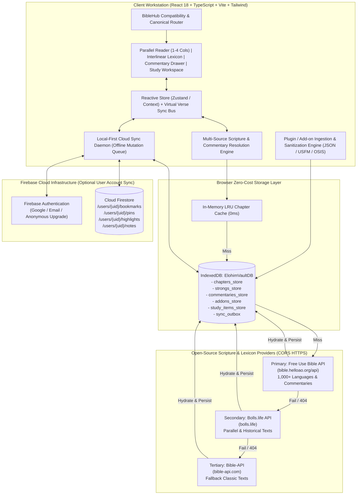
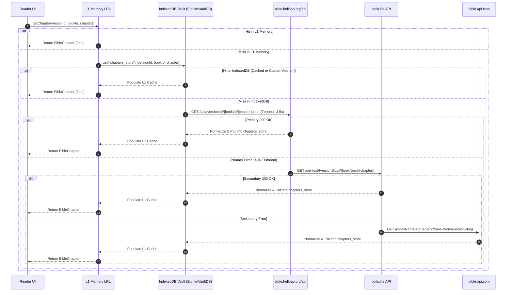
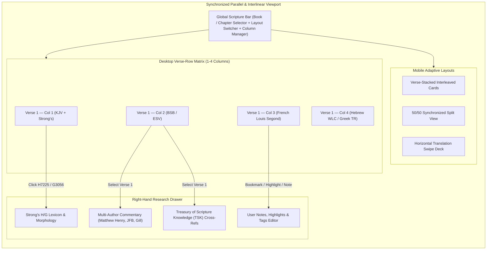
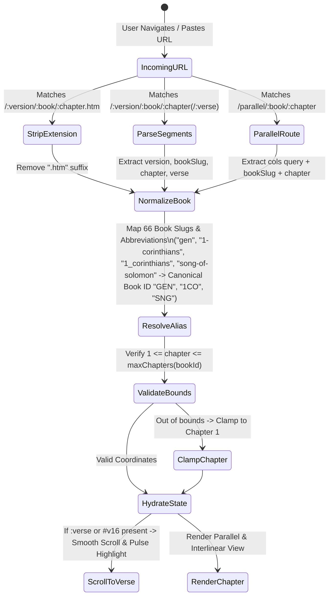
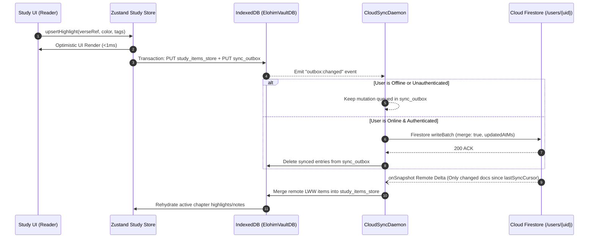

# ELOHIM BIBLE HUB — Master System Architecture
**Author:** Elder 1 — Prometheus (Supreme Systems Architect)  
**Project:** ELOHIM BIBLE HUB (`c:\Users\kwame\Downloads\bible`)  
**Status:** Production Engineering Specification (v1.0.0)

---

## 1. Executive Summary & Architectural Philosophy

**ELOHIM BIBLE HUB** is a generational, zero-ad, offline-first multilingual parallel Bible research workstation, interlinear Strong's lexicon, open-source commentary engine, extensible add-on translation manager, and YouVersion-grade cloud study synchronization platform.

### Core Architectural Tenets
1. **Zero-Ad, Zero-Telemetry Sanctuary:** 100% free of commercial trackers, ad networks, or behavioral profiling. Every byte of network and CPU budget is dedicated to scripture rendering and theological research.
2. **0ms Local-First Speed (Browser IndexedDB Vault):** Primary scriptures, Strong's numbers, and user study states (bookmarks, pins, highlights, markdown notes) resolve instantaneously from an in-browser IndexedDB storage engine (`ElohimVaultDB`) backed by an in-memory LRU cache.
3. **Multi-Tier Failover Scripture Resolution:** When a user requests any of 1,000+ global languages or historical translations, the resolution engine cascades gracefully from pre-bundled core assets -> IndexedDB Offline Vault -> Free Use Bible API (`bible.helloao.org`) -> Bolls Life API (`bolls.life`) -> Bible-API (`bible-api.com`).
4. **Synchronized Parallel & Interlinear Viewport:** Supports 1 to 4 independent translation columns on desktop and adaptive Split / Swipe / Verse-Stacked layouts on mobile, linked by a sub-millisecond `IntersectionObserver` + virtualized verse anchor bus.
5. **100% Legacy URL Compatibility:** Native support for BibleHub-style URLs (`/:version/:book/:chapter` and `/:version/:book/:chapter.htm`) alongside canonical SEO routes and deep-linked verse ranges (`/:version/:book/:chapter#v1-v5`).

---

## 2. High-Level System Topology



---

## 3. Multi-Source Scripture Resolution Pipeline

To guarantee uninterrupted study whether in a high-speed fiber environment or offline in remote mission fields, every chapter and commentary request passes through a deterministic 5-stage resolution pipeline:

1. **Stage 0 — L1 In-Memory LRU Cache (0ms):** Stores the last 50 rendered chapters and active Strong's lexicon entries in a typed `Map<string, BibleChapter>`.
2. **Stage 1 — Pre-Bundled Core Corpus (0–2ms):** Essential foundational texts (e.g., KJV with Strong's tokens, BSB/WEB core genesis/gospel packs, and core Strong's Hebrew/Greek dictionary keys) are shipped or pre-cached via Service Worker & local JSON chunks.
3. **Stage 2 — IndexedDB Offline Vault (`ElohimVaultDB`, 2–8ms):** Queries the `chapters_store` using compound key `[versionId, bookId, chapterNumber]`. User-installed Custom Language Add-on packs also live permanently in this store.
4. **Stage 3 — Primary Remote Provider (`https://bible.helloao.org/api`):** Fetches full chapters, available translations (`available_translations.json`), and public-domain commentaries (Matthew Henry, Jamieson-Fausset-Brown, John Gill, etc.). Automatically normalizes response payloads and writes through to IndexedDB + L1 Memory Cache.
5. **Stage 4 & 5 — Secondary (`https://bolls.life`) & Tertiary (`https://bible-api.com`) Failover:** If a specific translation slug or chapter is unavailable on the primary API or encounters a network timeout (>3500ms), the `AbortController` triggers an automatic failover to `bolls.life/get-text/{translation}/{book}/{chapter}/` and subsequently `bible-api.com/{book}+{chapter}?translation={id}`.



---

## 4. Parallel & Interlinear Synchronization Engine

ELOHIM BIBLE HUB provides a surgical multi-column parallel reader alongside a word-by-word Hebrew (Masoretic / WLC) and Greek (Nestle / Textus Receptus / SBLGNT) interlinear inspector.

### Desktop vs. Mobile Layout Modes
- **Desktop Viewport (`>= 1024px`):**
  - Supports **1 to 4 simultaneous translation columns** (`grid-cols-1` through `grid-cols-4`), plus an optional docked right-hand **Lexicon & Commentary Inspector Drawer**.
  - **Verse-Row Alignment Matrix:** Rather than scrolling 4 independent unstructured text blobs that drift out of alignment when verse lengths differ across languages (e.g., German vs. Chinese vs. English), the Parallel Engine renders a **CSS Grid Verse-Row Matrix** where each verse number `v` forms a horizontal row across all active columns (`[Col1_V1, Col2_V1, Col3_V1, Col4_V1]`). Every translation stays locked at the exact pixel baseline for every verse.
- **Mobile & Tablet Viewport (`< 1024px`):**
  - **Verse-Stacked Interleaved Mode (Default Parallel):** For each verse `1..N`, renders a unified card stacking Translation A, Translation B, and Translation C vertically with distinct language pills.
  - **Split-Screen Dual Pane Mode:** Top 50% / Bottom 50% synchronized scroll panes connected via `VerseAnchorSyncBus`.
  - **Swipe Carousel Mode:** Horizontal snap-scroll between active translations while preserving the exact top visible `data-verse-id`.

### Interlinear & Strong's Lexicon Token Pipeline
Every word token in interlinear-capable translations carries a structured `InterlinearToken` payload:
- Surface text (English/Target language)
- Original script word (Vocalized Hebrew `עברית` or Polytonic Greek `Ἑλληνική`)
- Transliteration (`bereshit`, `logos`)
- Strong's Concordance ID (`H7225`, `G3056`)
- Morphological parsing code (e.g., `Prep-b | N-fs` or `V-PAI-3S`)

Clicking or hovering any Strong's badge dispatches `selectStrongsEntry(strongsId)` to the Lexicon Drawer, immediately displaying:
1. Original lemma, phonetic pronunciation, and part of speech.
2. Brown-Driver-Briggs (BDB) / Thayer's Greek Lexicon unabridged definition.
3. KJV / BSB translation frequency breakdown and concordance occurrences across the Bible.



---

## 5. BibleHub URL Compatibility & Canonical Router

Users and scholars frequently paste or navigate via legacy BibleHub URL patterns or standard citation links. Our router normalizes all incoming URL formats into a canonical state without page reloads or 404 traps.

### Supported Route Patterns
1. **BibleHub `.htm` File Pattern:**
   - `/:version/:book/:chapter.htm` (e.g., `/kjv/genesis/1.htm`, `/niv/john/3.htm`, `/interlinear/genesis/1.htm`, `/commentaries/romans/8.htm`)
2. **Standard Clean Hierarchical Pattern:**
   - `/:version/:book/:chapter` (e.g., `/bsb/psalms/23`, `/esv/matthew/5`)
3. **Verse-Targeted Pattern:**
   - `/:version/:book/:chapter/:verse` or `/:version/:book/:chapter#v:verse` (e.g., `/kjv/john/3/16` or `/kjv/john/3.htm#v16`)
4. **Parallel Comparison URL Pattern:**
   - `/parallel/:book/:chapter?cols=kjv,bsb,lsg,wlc`



---

## 6. Plugin / Add-on Language & Version Manager

To empower global communities, translators, and scholars studying rare dialects or indigenous translations not yet hosted on public APIs, ELOHIM BIBLE HUB includes a zero-server **Custom Language & Version Add-on Manager**:

- **Supported Ingestion Formats:**
  1. **ELOHIM Standard Bible JSON (`.elohim.json` / `.json`)**: Direct structured schema with metadata, books, chapters, and verses.
  2. **USFM (`.usfm` / `.sfm`)**: Unified Standard Format Markers (`\id`, `\c`, `\v`, `\w ... \w*` Strong's milestones) used by Wycliffe / Paratext translation teams worldwide.
  3. **OSIS XML / Zefania XML (`.osis.xml` / `.xml`)**: Open Scripture Information Standard XML files.
- **Ingestion Pipeline:**
  - Runs inside a dedicated **Web Worker (`addonParser.worker.ts`)** so parsing a 4.5 MB full Bible XML/USFM file never blocks the 60fps main UI thread.
  - Passes every verse string through a strict whitelist sanitizer (`DOMPurify` / structural AST stripper) to guarantee zero XSS vectors.
  - Indexes the parsed translation into `ElohimVaultDB.addons_store` and `ElohimVaultDB.chapters_store`, making it immediately selectable in any of the 4 parallel columns and searchable offline.

---

## 7. Local-First IndexedDB + Firebase Cloud Sync Architecture

User study artifacts—**Bookmarks**, **Pins** (quick-jump anchor tabs), **Highlights** (customizable palette colors + underline styles + topical tags), and **Verse Notes** (rich Markdown + linked cross-references)—are architected **Local-First**:

1. **Zero-Latency Local Write:** Every action writes immediately to `ElohimVaultDB.study_items_store` and appends an idempotent mutation record to `ElohimVaultDB.sync_outbox`. The UI updates in `< 2ms` without waiting for network round-trips.
2. **Authenticated Cloud Sync (Firebase Auth + Firestore):**
   - Users can study 100% anonymously offline forever.
   - When signed in via Firebase Auth (Google OAuth or Email/Password), the `CloudSyncDaemon` drains `sync_outbox` in batched `writeBatch` transactions to `/users/{uid}/study_items/{itemId}`.
   - Conflict Resolution uses **Last-Write-Wins (LWW) with Vector Timestamps (`updatedAtMs` + `deviceId`)** and soft-delete tombstones (`deleted: true`) so deletions propagate cleanly across desktop and mobile devices without resurrecting stale items.



---

## 8. Directory & Module Blueprint

```text
c:\Users\kwame\Downloads\bible\
├── docs/
│   ├── ARCHITECTURE.md          # System architecture & Mermaid diagrams (Elder 1)
│   ├── SCHEMA.md                # TypeScript, IndexedDB & Firestore schemas (Elder 2)
│   ├── API_SPEC.md              # OpenAPI 3.1 & external API contracts (Elder 3)
│   ├── SECURITY.md              # Firestore rules, add-on sanitization, privacy (Elder 4)
│   └── DEVOPS.md                # SSG build, Firebase 112 hosting, PWA & CWV (Elder 5)
├── src/
│   ├── types/                   # Core TypeScript interfaces (Bible, Strongs, Study, Addons)
│   ├── data/                    # Canonical 66-book metadata, core bundled verses & Strongs seed
│   ├── services/
│   │   ├── db/                  # IndexedDB ElohimVaultDB wrapper & zero-cost cache
│   │   ├── api/                 # Multi-source resolver (helloao, bolls.life, bible-api)
│   │   ├── addons/              # JSON / USFM / OSIS parser & sanitizer
│   │   └── sync/                # Firebase Auth + Firestore Local-First sync engine
│   ├── store/                   # Global reactive state (Reader columns, active lexicon, study items)
│   ├── components/
│   │   ├── header/              # Omni-Command bar, Book/Chapter picker, Parallel column controls
│   │   ├── reader/              # Parallel Verse-Row Matrix, Interlinear tokens, Mobile views
│   │   ├── drawer/              # Strong's Lexicon, Commentaries, TSK Cross-Refs, Note Editor
│   │   ├── modals/              # Add-on Language Manager, Bookmarks/Pins Vault, Auth Sync Modal
│   │   └── seo/                 # Canonical URL & BibleHub .htm route handler
│   └── App.tsx
└── build-ssg.js                 # Post-Vite SSG prerender & sitemap generator
```
