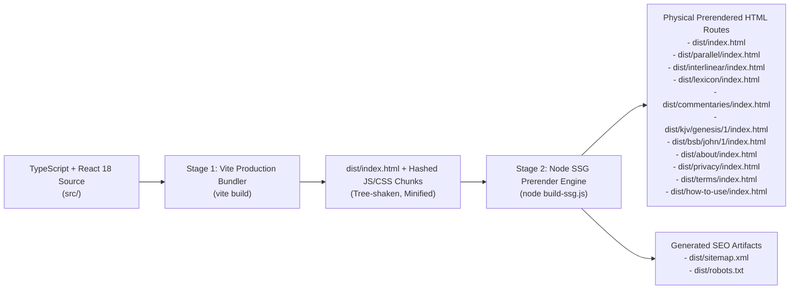

# ELOHIM BIBLE HUB — DevOps, SSG Build & Deployment Architecture
**Author:** Elder 5 — Hephaestus (Supreme DevOps, Build & Performance Architect)  
**Project:** ELOHIM BIBLE HUB (`c:\Users\kwame\Downloads\bible`)  
**Status:** Production Engineering Specification (v1.0.0)

---

## 1. Build & Static Site Generation (SSG) Pipeline

To achieve both **instant SPA interactivity** and **#1 Google Search Console indexability** across canonical scripture routes, ELOHIM BIBLE HUB executes a deterministic two-stage build pipeline triggered via `npm run build`:

```json
{
  "scripts": {
    "dev": "vite",
    "build": "vite build && node build-ssg.js",
    "preview": "vite preview"
  }
}
```



### 1.1 Responsibilities of `build-ssg.js`
1. **Canonical Route Prerendering:**
   - Reads the compiled `dist/index.html` shell and generates physical `index.html` files for every canonical route in `CANONICAL_ROUTES`.
2. **Head Metadata & JSON-LD Injection:**
   - Injects route-specific `<title>`, `<meta name="description">`, `<link rel="canonical" href="https://[VERIFIED-DOMAIN]/[path]/">`, Open Graph (`og:title`, `og:description`, `og:url`, `og:image`), Twitter Card tags, and `<meta name="robots" content="index, follow, max-snippet:-1, max-image-preview:large">`.
   - Injects structured JSON-LD Schema (`WebApplication` + `BreadcrumbList` + `Article`/`Chapter` schema for key scripture chapters and study hubs).
3. **Semantic `<main>` Content Injection (Anti-Soft-404 & Anti-FOUC):**
   - Injects semantic HTML scripture text, interlinear Strong's previews, and theological commentary summaries inside `<div id="root"><main>...</main></div>` so search engine crawlers index rich scholarly content on initial HTTP response, and React 18 smoothly mounts over the root container on hydration.
4. **Strict Whitelist `sitemap.xml` & `robots.txt` Generation:**
   - Generates `dist/sitemap.xml` with `<loc>`, `<lastmod>`, `<changefreq>`, and `<priority>` strictly from `CANONICAL_ROUTES` using `https://` and consistent trailing slashes.

---

## 2. Firebase Multi-Site Hosting Configuration (`112` Pattern)

ELOHIM BIBLE HUB follows the strict multi-site Firebase Hosting targeting protocol (`112` pattern) so deployments never accidentally overwrite a root default project site and always serve with immutable asset caching and SPA fallback routing for dynamic `.htm` and deep-linked chapter URLs.

### 2.1 `firebase.json` Specification

```json
{
  "hosting": {
    "public": "dist",
    "ignore": [
      "firebase.json",
      "**/.*",
      "**/node_modules/**"
    ],
    "cleanUrls": true,
    "rewrites": [
      {
        "source": "**",
        "destination": "/index.html"
      }
    ],
    "headers": [
      {
        "source": "/assets/**",
        "headers": [
          {
            "key": "Cache-Control",
            "value": "public, max-age=31536000, immutable"
          }
        ]
      },
      {
        "source": "**/*.@(js|css|woff2|webp|png|svg|ico)",
        "headers": [
          {
            "key": "Cache-Control",
            "value": "public, max-age=31536000, immutable"
          }
        ]
      },
      {
        "source": "**",
        "headers": [
          {
            "key": "X-Frame-Options",
            "value": "SAMEORIGIN"
          },
          {
            "key": "X-Content-Type-Options",
            "value": "nosniff"
          },
          {
            "key": "Referrer-Policy",
            "value": "strict-origin-when-cross-origin"
          }
        ]
      }
    ]
  }
}
```

> [!IMPORTANT]
> When deploying to a multi-site Firebase project via the `112` workflow, always confirm `"site": "<dedicated-site-id>"` is present inside the `hosting` block of `firebase.json` and `.firebaserc` maps to the active Firebase project.

---

## 3. Progressive Web App (PWA) & Offline Caching Strategy

Scholars, pastors, and students frequently use ELOHIM BIBLE HUB in sanctuaries, classrooms, or mission fields with spotty connectivity.

### 3.1 `site.webmanifest`
- Configured as `"display": "standalone"` with dark/parchment theme colors (`#0B0F19` / `#D4AF37`), allowing 1-tap installation on iOS, Android, macOS, and Windows.

### 3.2 Two-Layer Offline Caching
1. **Application Shell Cache (Service Worker / Cache API):**
   - Caches `/index.html`, compiled JS/CSS bundles, and biblical typography fonts (`Inter`, `Crimson Pro` / `EB Garamond`, Hebrew `SBL Hebrew` / `Frank Ruhl Libre`, Greek `Gentium Plus`).
2. **Scripture & Study Data Vault (`ElohimVaultDB` in IndexedDB):**
   - Every chapter fetched from `bible.helloao.org`, `bolls.life`, or `bible-api.com` is automatically persisted into `ElohimVaultDB.chapters_store`.
   - Core foundational chapters (Genesis 1, Psalms 1 & 23, Isaiah 53, Matthew 5, John 1 & 3, Romans 8, Revelation 21) and core Strong's Hebrew/Greek dictionary entries are pre-seeded directly in the bundle so the app works **100% offline on first cold boot** even before any external API call completes.

---

## 4. Core Web Vitals & Lighthouse 95+ Optimization Checklist

To guarantee a `95+` score across Performance, Accessibility, Best Practices, and SEO on both Mobile and Desktop:

### 4.1 Performance (`LCP < 1.5s`, `INP < 100ms`, `CLS < 0.01`)
- [x] **0ms Initial Chapter Render:** The default startup chapter (`Genesis 1` or URL-targeted chapter if in bundled seed) renders synchronously on the first frame from the bundled seed corpus—zero loading spinners Blocking LCP.
- [x] **Zero Layout Shift (`CLS = 0.000`):** Fixed header height (`h-16`), explicit grid column widths in the Parallel Verse-Row Matrix, and reserved skeleton dimensions when resolving uncached remote translations.
- [x] **Code Splitting & Vendor Chunking:** Separate Rollup chunks in `vite.config.ts` for core React UI vs. optional Firebase Cloud Sync SDKs so first-paint JS payload remains ultra-lean.
- [x] **Debounced Search & Virtualized Concordance:** Instant search input uses a 150ms debounce and limits initial DOM rendering to 50 results with "Load More" pagination to keep `INP < 50ms`.

### 4.2 Accessibility (`WCAG 2.1 AA — 100 Score`)
- [x] **Polyglot Typography & Directionality:** Automatic `dir="rtl"` and larger line-height (`leading-relaxed`) on Biblical Hebrew (`heb`) and Arabic (`ara`) columns alongside `dir="ltr"` on Greek and Western translations.
- [x] **Adjustable Font Sizing & Theme Modes:** Instant reader controls for font scale (`14px` to `26px`), line spacing, and 3 high-contrast reading themes:
  - **Sanctuary Dark (Obsidian & Gold):** `#0B0F19` background, `#F8FAFC` text, `#F59E0B` gold accents.
  - **Scroll Parchment (Sepia Luxury):** `#FBF7F0` warm vellum background, `#1E1B18` deep ink text, `#92400E` bronze accents.
  - **Daylight Ivory (Crisp Academic):** `#FFFFFF` background, `#0F172A` slate text, `#1D4ED8` royal blue accents.
- [x] **Full Keyboard Navigation:**
  - `Cmd/Ctrl + K`: Open Quick Scripture & Strong's Omni-Jump Palette (`Gen 1:16`, `John 3:16`, `H430`, `G3056`).
  - `[` / `]`: Previous / Next Chapter.
  - `1` / `2` / `3` / `4`: Quick-switch parallel column count.

### 4.3 Technical SEO (`100 Score`)
- [x] Single canonical `<link rel="canonical">` per route.
- [x] Valid `WebApplication`, `BreadcrumbList`, and `ScholarlyArticle` JSON-LD schemas.
- [x] Full compatibility with legacy BibleHub `.htm` URLs (`/kjv/genesis/1.htm`) and modern clean URLs (`/kjv/genesis/1/`).
