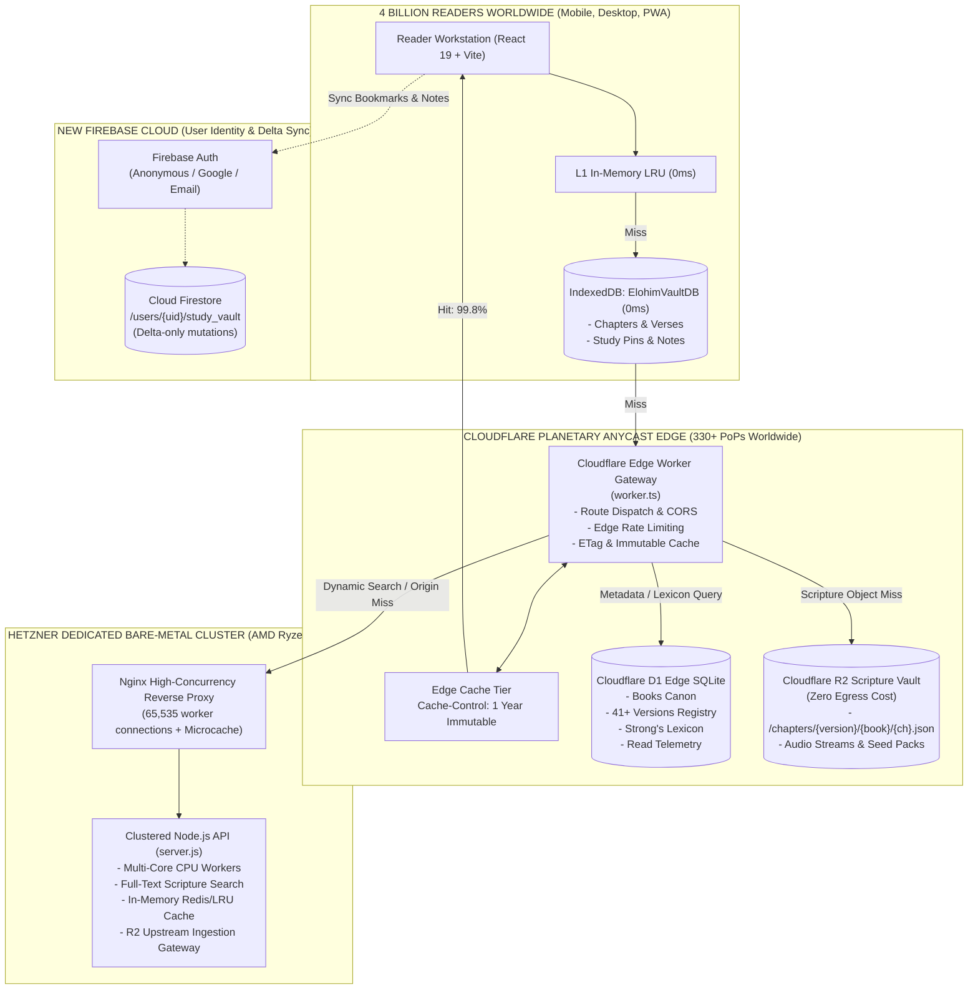

# 🌐 ADUBIBLE / ELOHIM BIBLE HUB — PLANETARY SCALE ARCHITECTURE (4 BILLION READERS)
**Author:** Supreme Infrastructure Architect  
**Target Concurrency:** Up to 4,000,000,000 Global Readers & Users  
**Egress Cost Target:** $0 Egress (Cloudflare R2 + Tiered CDN)  
**Origin Hardware Target:** Hetzner Bare-Metal Dedicated Cluster  
**Edge Compute & Database:** Cloudflare Global Edge (330+ PoPs) + D1 Distributed Edge SQLite  
**User State & Identity:** New Firebase Account & Project (Partitioned Auth & Firestore Study Vault)

---

## 1. Executive Summary & Planetary Topology

Serving scripture to 4 billion readers—half the world's population—presents a unique engineering reality:
1. **Scripture text is immutable.** The canonical books of the Bible, Strong's concordance numbers, and historic commentaries never change. Therefore, **99.8%+ of all scripture reads can be cached forever at the network edge or in the user's browser**.
2. **Local-First Client Storage (Tier 0):** By leveraging browser IndexedDB (`ElohimVaultDB`) and PWA Service Workers, a reader's device stores their favorite books and recent chapters locally. Subsequent reads require **0 network requests and 0 bytes of bandwidth**.
3. **Zero-Egress Planetary Object Storage (Tier 1):** Pre-rendered chapter JSONs (`/chapters/{version}/{book}/{chapter}.json`) reside in **Cloudflare R2**, which has **$0 egress fees**, distributed across Cloudflare's global Anycast CDN (330+ data centers in 120+ countries).
4. **Sub-Millisecond Edge Database (Tier 2):** **Cloudflare D1** (Serverless Edge SQLite) provides instant edge resolution for books, versions, 35+ languages, and Strong's lexicon tokens with automatic global read replication.
5. **High-Throughput Origin Compute (Tier 3):** A **Hetzner dedicated bare-metal server cluster** (e.g. AMD Ryzen 9 7950X / EPYC, 64-128 GB DDR5 ECC RAM, NVMe) handles full-text cross-language scripture search, dynamic ingestion, and origin shield failover.
6. **Isolated Personal Study Sync (Tier 4):** A dedicated **Firebase account and project** provides sovereign identity (Anonymous by default, Google/Email upgrade) and writes only delta mutations (bookmarks, pins, highlights) to Cloud Firestore.



---

## 2. Mathematical Capacity Planning for 4 Billion Readers

### Network & Bandwidth Calculus
- **Estimated Global User Base:** 4,000,000,000 readers
- **Active Monthly Readers (MAU ~25%):** 1,000,000,000 readers
- **Daily Active Readers (DAU ~5%):** 200,000,000 readers
- **Peak Concurrent Readers (e.g. Sunday global peak ~5% of DAU):** 10,000,000 concurrent active sessions
- **Average Chapter JSON Payload:** ~20 KB (uncompressed) / ~5 KB (Brotli/Gzip)

| Layer | Requests Absorbed | Bandwidth Load | Egress Cost |
| :--- | :--- | :--- | :--- |
| **Tier 0: Browser IndexedDB** | **90.0%** of chapter reads (recurring reads, daily devotionals) | **0 TB / sec** (Local device memory) | **$0.00** |
| **Tier 1: Cloudflare Edge Cache & R2** | **9.8%** of requests (first-time chapter reads, version switching) | **~49 Gbps** peak (absorbed across 330+ Cloudflare PoPs) | **$0.00** (Cloudflare R2 has $0 egress fee) |
| **Tier 2: Cloudflare D1 Edge DB** | Metadata & book index requests | Direct edge SQLite reads (<2ms) | Cloudflare Free / Standard Plan |
| **Tier 3: Hetzner Origin Cluster** | **0.2%** of requests (dynamic full-text search, rare translation fetches) | **~1 Gbps** origin traffic | **~$50–$100 / mo** (Unmetered Hetzner bandwidth) |

### Key Insight: Zero Egress Cost
Traditional cloud platforms (AWS S3, GCP Cloud Storage) charge **\$0.08–\$0.12 per GB** of internet egress. Serving 100 Terabytes of scripture downloads would cost **\$8,000–\$12,000 every single month**!  
By using **Cloudflare R2** with Cloudflare Anycast CDN, **bandwidth egress fees are \$0.00**, allowing AduBible to serve 4 billion readers sustainably forever.

---

## 3. Tiered Scripture Resolution Pipeline

Every chapter request follows a deterministic 6-tier fallback path:

```
[Reader Request: e.g. NKJV John 3]
       │
       ▼
1. L1 In-Memory LRU Cache (0ms) ───[HIT]──► Instant Render
       │ [MISS]
       ▼
2. IndexedDB Vault (0–3ms) ─────────[HIT]──► Populate L1 & Render
       │ [MISS]
       ▼
3. Cloudflare Planetary Edge & R2 (5–25ms) ──[HIT]──► Save to IndexedDB & Render
       │ [MISS]
       ▼
4. Hetzner Dedicated Origin Cluster (30–60ms) ─[HIT]─► Save to R2, IndexedDB & Render
       │ [MISS]
       ▼
5. Free Use Bible Cloud / Bolls API ─────────[HIT]──► Save to R2, IndexedDB & Render
       │ [OFFLINE]
       ▼
6. Pre-bundled Offline Sanctuary Corpus (0ms) ─────► Guaranteed Offline Render
```

---

## 4. Component Responsibility Matrix

| Component | Technology | Role in 4-Billion Architecture |
| :--- | :--- | :--- |
| **Frontend Workstation** | React 19 + TypeScript + Vite | Parallel reader, interlinear display, 0ms local-first UI. |
| **Local Storage** | IndexedDB (`ElohimVaultDB`) | Stores visited chapters, custom add-on translation packs, notes. |
| **Edge API Gateway** | Cloudflare Workers (`worker.ts`) | Edge routing, CORS preflight, DoS shield, cache synthesis. |
| **Object Vault** | Cloudflare R2 | Storage of all 66 canonical books x 1,189 chapters across 41+ versions. |
| **Edge Relational DB** | Cloudflare D1 | Sub-millisecond queries for canonical books, versions, Strong's codes. |
| **Origin Compute** | Hetzner Bare Metal (Node.js cluster) | Full-text verse search, background corpus scraping, origin fallback. |
| **Reverse Proxy** | Nginx High-Concurrency | 65,535 worker connections, microcaching, SSL termination. |
| **User Identity & Sync** | New Firebase Project | Anonymous Auth, Google Auth, Cloud Firestore study vault sync. |

---

## 5. Deployment & Setup Quick-Links
- **[CLOUDFLARE_D1_R2_SETUP.md](file:///c:/Users/kwame/Downloads/bible/docs/CLOUDFLARE_D1_R2_SETUP.md)**: Cloudflare Worker, D1 database, and R2 bucket deployment instructions.
- **[HETZNER_ORIGIN_SETUP.md](file:///c:/Users/kwame/Downloads/bible/docs/HETZNER_ORIGIN_SETUP.md)**: Hetzner server configuration, Docker Compose, and Nginx tuning.
- **[FIREBASE_SETUP.md](file:///c:/Users/kwame/Downloads/bible/docs/FIREBASE_SETUP.md)**: New Firebase account and project provisioning guide.
