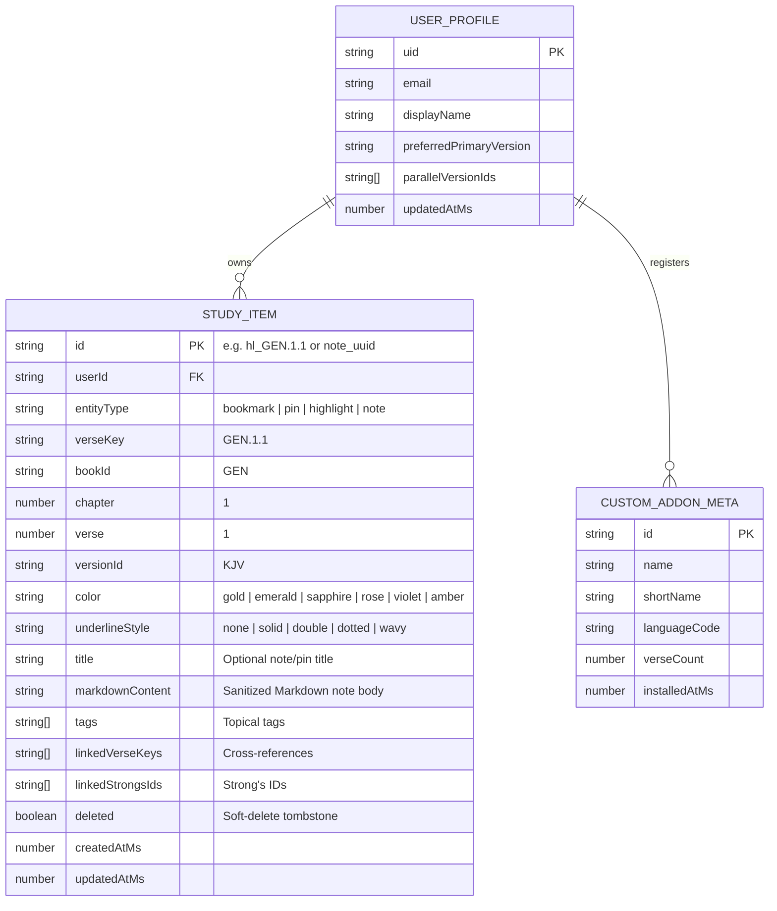

# ELOHIM BIBLE HUB — Master Data & Storage Schemas
**Author:** Elder 2 — Atlas (Supreme Data & Storage Architect)  
**Project:** ELOHIM BIBLE HUB (`c:\Users\kwame\Downloads\bible`)  
**Status:** Production Engineering Specification (v1.0.0)

---

## 1. Core Scripture & Lexicon TypeScript Interfaces

All scripture entities, interlinear tokens, Strong's dictionary records, commentaries, and user study states adhere to strict, zero-`any` TypeScript contracts shared across the UI, IndexedDB (`ElohimVaultDB`), and Cloud Firestore.

### 1.1 Canonical Book & Language Identifiers

```typescript
/**
 * Standard 3-letter USFM / OSIS Book Identifiers (66 Canonical Books)
 */
export type CanonicalBookId =
  // Old Testament (39)
  | 'GEN' | 'EXO' | 'LEV' | 'NUM' | 'DEU'
  | 'JOS' | 'JDG' | 'RUT' | '1SA' | '2SA'
  | '1KI' | '2KI' | '1CH' | '2CH' | 'EZR'
  | 'NEH' | 'EST' | 'JOB' | 'PSA' | 'PRO'
  | 'ECC' | 'SNG' | 'ISA' | 'JER' | 'LAM'
  | 'EZK' | 'DAN' | 'HOS' | 'JOL' | 'AMO'
  | 'OBA' | 'JON' | 'MIC' | 'NAM' | 'HAB'
  | 'ZEP' | 'HAG' | 'ZEC' | 'MAL'
  // New Testament (27)
  | 'MAT' | 'MRK' | 'LUK' | 'JHN' | 'ACT'
  | 'ROM' | '1CO' | '2CO' | 'GAL' | 'EPH'
  | 'PHP' | 'COL' | '1TH' | '2TH' | '1TI'
  | '2TI' | 'TIT' | 'PHM' | 'HEB' | 'JAS'
  | '1PE' | '2PE' | '1JN' | '2JN' | '3JN'
  | 'JUD' | 'REV';

export type Testament = 'OT' | 'NT';

export type BookCategory =
  | 'Pentateuch'
  | 'Historical'
  | 'Poetic'
  | 'Major Prophets'
  | 'Minor Prophets'
  | 'Gospels'
  | 'Acts'
  | 'Pauline Epistles'
  | 'General Epistles'
  | 'Apocalyptic';

export interface BibleLanguage {
  /** ISO 639-1 or 639-3 code (e.g., 'en', 'heb', 'grc', 'fr', 'es', 'twi', 'yor', 'zh') */
  code: string;
  /** English name of the language (e.g., 'Biblical Hebrew', 'Koine Greek', 'French') */
  name: string;
  /** Native autonym (e.g., 'עברית', 'Ἑλληνική', 'Français', 'Español', 'Twi') */
  nativeName: string;
  /** Text direction for layout and typography rendering */
  direction: 'ltr' | 'rtl';
  /** Preferred font stack token ('serif' | 'hebrew' | 'greek' | 'sans' | 'cjk') */
  scriptFamily: 'latin' | 'hebrew' | 'greek' | 'arabic' | 'cyrillic' | 'cjk' | 'ethiopic' | 'devanagari' | 'other';
  /** Number of available versions in this language */
  versionCount?: number;
}

export interface BibleVersion {
  /** Unique normalized version identifier (e.g., 'BSB', 'KJV', 'WLC', 'SBLGNT', 'eng_kjv', 'fra_lsg') */
  id: string;
  /** Short display abbreviation (e.g., 'KJV', 'BSB', 'LSG', 'RVR1909', 'WLC') */
  shortName: string;
  /** Full formal title (e.g., 'Berean Standard Bible', 'King James Version (1769) with Strongs') */
  name: string;
  /** ISO language code linking to BibleLanguage.code */
  languageCode: string;
  /** Native language display name */
  languageName: string;
  /** Text direction */
  direction: 'ltr' | 'rtl';
  /** Whether this version contains word-level Strong's Concordance & morphological tokens */
  hasInterlinear: boolean;
  /** Whether this version includes Old Testament, New Testament, or both */
  scope: 'BOTH' | 'OT' | 'NT';
  /** Upstream source provider used to resolve chapters */
  sourceProvider: 'bundled' | 'helloao' | 'bolls' | 'bible-api' | 'custom-addon';
  /** Provider-specific slug or ID (e.g., 'BSB' on helloao, 'YLT' on bolls) */
  providerSlug: string;
  /** Public domain or Creative Commons license attribution string */
  license: string;
  /** Publication year if known */
  year?: number;
  /** Whether all chapters of this version are downloaded into IndexedDB for 100% offline use */
  isDownloadedOffline?: boolean;
}

export interface BibleBook {
  /** Canonical 3-letter ID (e.g., 'GEN', 'JHN') */
  id: CanonicalBookId;
  /** 1-based canonical order (1 = Genesis ... 66 = Revelation) */
  bookNumber: number;
  /** Standard English book name */
  name: string;
  /** Localized book name in the active BibleVersion */
  localizedName: string;
  /** URL-friendly slug matching BibleHub convention (e.g., 'genesis', '1_corinthians', 'song_of_solomon') */
  bibleHubSlug: string;
  /** Accepted URL aliases (e.g., ['gen', 'ge', 'genesis']) */
  aliases: string[];
  /** Testament classification */
  testament: Testament;
  /** Theological division category */
  category: BookCategory;
  /** Total number of chapters in the book */
  totalChapters: number;
}
```

---

### 1.2 Chapter, Verse, and Interlinear Token Schemas

```typescript
export interface InterlinearToken {
  /** 0-based position of token within the verse */
  index: number;
  /** Surface text in the target/translation language (e.g., 'In the beginning', 'created', 'God') */
  surface: string;
  /** Original Hebrew (Masoretic) or Greek word in native script (e.g., 'בְּרֵאשִׁית', 'ἐν', 'ἀρχῇ') */
  originalWord?: string;
  /** Unpointed/consonantal lemma for search matching */
  lemma?: string;
  /** Phonetic English transliteration (e.g., 'bə·rê·šîṯ', 'en', 'archē') */
  transliteration?: string;
  /** Strong's Concordance reference ID ('H7225' for Hebrew, 'G746' for Greek) */
  strongsId?: string;
  /** Secondary Strong's IDs if compound prefix/stem (e.g., ['H9003', 'H7225']) */
  compoundStrongsIds?: string[];
  /** Morphological parsing code (e.g., 'Prep-b | N-fs', 'V-Qal-Perf-3ms', 'N-DSF') */
  morphologyCode?: string;
  /** Human-readable morphology expansion (e.g., 'Preposition-b | Noun - feminine singular') */
  morphologyExpansion?: string;
  /** Punctuation immediately following the token */
  punctuation?: string;
}

export interface VerseFootnote {
  id: string;
  caller: string;
  text: string;
  referenceVerse?: number;
}

export interface BibleVerse {
  /** Canonical composite reference key: `${bookId}.${chapter}.${verse}` (e.g., 'GEN.1.1') */
  verseKey: string;
  /** Canonical book ID */
  bookId: CanonicalBookId;
  /** 1-based chapter number */
  chapter: number;
  /** 1-based verse number */
  verse: number;
  /** Plain rendered text of the verse (stripped of raw markup tags) */
  text: string;
  /** Optional section heading that precedes this verse (e.g., 'The Creation of the World') */
  heading?: string;
  /** Optional word-by-word interlinear & Strong's tokens */
  tokens?: InterlinearToken[];
  /** Optional translator or manuscript footnotes */
  footnotes?: VerseFootnote[];
  /** Whether the verse contains Words of Christ (for optional Red-Letter edition rendering) */
  isRedLetter?: boolean;
}

export interface BibleChapter {
  /** Composite primary key for IndexedDB: `${versionId}:${bookId}:${chapter}` */
  id: string;
  versionId: string;
  bookId: CanonicalBookId;
  bookName: string;
  chapter: number;
  direction: 'ltr' | 'rtl';
  verses: BibleVerse[];
  audioUrl?: string;
  /** Unix timestamp (ms) when cached into IndexedDB */
  cachedAtMs: number;
}
```

---

## 2. Strong's Lexicon & Commentary Schemas

### 2.1 Strong's Concordance Entry (`StrongsEntry`)

```typescript
export interface StrongsEntry {
  /** Normalized Strong's Key: 'H1'..'H8674' (Hebrew/Aramaic) or 'G1'..'G5624' (Greek) */
  id: string;
  /** Language corpus ('hebrew' includes Biblical Aramaic entries in OT) */
  lexiconType: 'hebrew' | 'greek';
  /** Original script lemma (e.g., 'אֱלֹהִים' or 'λόγος') */
  lemma: string;
  /** Phonetic transliteration (e.g., 'ʼĕlôhîym' or 'lógos') */
  transliteration: string;
  /** Phonetic pronunciation guide (e.g., 'el-o-heem' or 'log-os') */
  pronunciation: string;
  /** Part of speech classification (e.g., 'Noun Masculine Plural', 'Verb Qal', 'Noun Masculine') */
  partOfSpeech: string;
  /** Root derivation / etymology (e.g., 'plural of H433; gods in the ordinary sense; but specifically used of the supreme God') */
  derivation: string;
  /** Concise Strong's gloss definition */
  shortDefinition: string;
  /** Full unabridged Brown-Driver-Briggs (BDB) or Thayer's Greek Lexicon entry (supports structured HTML/Markdown) */
  fullDefinition: string;
  /** Authorized Version (KJV) / BSB translation count breakdown (e.g., [{ rendering: 'God', count: 2346 }, { rendering: 'gods', count: 240 }]) */
  translationCounts: Array<{
    rendering: string;
    count: number;
  }>;
  /** Total occurrences across the canonical scripture */
  totalOccurrences: number;
  /** Top key scripture references where this Strong's number appears */
  keyReferences: string[]; // e.g., ['GEN.1.1', 'DEU.6.4', 'PSA.82.1']
  /** Related / cognate Strong's numbers */
  relatedStrongsIds: string[];
}
```

### 2.2 Open-Source Commentary & Cross-Reference Entry (`CommentaryEntry`)

```typescript
export type CommentarySourceId =
  | 'matthew-henry'      // Matthew Henry's Complete Commentary on the Whole Bible
  | 'jfb'                // Jamieson-Fausset-Brown Bible Commentary
  | 'john-gill'          // John Gill's Exposition of the Entire Bible
  | 'geneva-notes'       // 1599 Geneva Bible Study Notes
  | 'keil-delitzsch'     // Keil & Delitzsch OT Commentary
  | 'robertson-wp'       // A.T. Robertson's Word Pictures in the New Testament
  | 'spurgeon-treasury'  // C.H. Spurgeon's Treasury of David (Psalms)
  | 'tsk';               // Treasury of Scripture Knowledge (Cross-References)

export interface CrossReferenceLink {
  /** Target verse key (e.g., 'JHN.1.1') */
  targetVerseKey: string;
  /** Human-readable citation (e.g., 'John 1:1-3') */
  displayRef: string;
  /** Anchor word or theme in the source verse */
  themeKeyword?: string;
  /** Relevance weight (1-100) from OpenBible / TSK dataset */
  votes?: number;
  /** Preview snippet of the target verse */
  previewText?: string;
}

export interface CommentaryNoteSection {
  /** Verse number (0 indicates Chapter Introduction / Overview) */
  verse: number;
  /** End verse if commentary spans a passage range (e.g., verses 1-5) */
  endVerse?: number;
  /** Commentator's title or lemma heading for this verse */
  title?: string;
  /** Sanitized structured exposition text (paragraphs, blockquotes, scripture refs) */
  content: string;
}

export interface CommentaryEntry {
  /** Primary key: `${commentaryId}:${bookId}:${chapter}` */
  id: string;
  commentaryId: CommentarySourceId;
  commentaryTitle: string;
  author: string;
  publicationYear: number;
  bookId: CanonicalBookId;
  chapter: number;
  /** Exposition sections indexed by verse */
  sections: CommentaryNoteSection[];
  /** TSK Cross-References mapped by verse number */
  crossReferencesByVerse?: Record<number, CrossReferenceLink[]>;
  cachedAtMs: number;
}
```

---

## 3. User Study Sync Entities (YouVersion-Grade Local + Cloud Sync)

All user study artifacts share a base synchronization envelope (`SyncableEntity`) to guarantee deterministic Last-Write-Wins (LWW) conflict resolution between `ElohimVaultDB` and Cloud Firestore.

```typescript
export interface SyncableEntity {
  /** Deterministic UUID v4 or composite key (e.g., `hl_GEN.1.1` or `note_9b1deb4d`) */
  id: string;
  /** Owner Firebase UID ('local' when unauthenticated) */
  userId: string;
  /** Creation epoch timestamp in milliseconds */
  createdAtMs: number;
  /** Last modification epoch timestamp in milliseconds (used for LWW resolution) */
  updatedAtMs: number;
  /** Soft-delete tombstone flag for cross-device deletion propagation */
  deleted?: boolean;
  /** Sync status indicator for UI badges */
  syncState: 'synced' | 'pending' | 'local-only' | 'error';
}

export type HighlightColor =
  | 'gold'      // #F59E0B — Divine Promises & Sovereignty
  | 'emerald'   // #10B981 — Growth, Life & Covenant
  | 'sapphire'  // #3B82F6 — Law, Wisdom & Truth
  | 'rose'      // #F43F5E — Atonement, Blood & Messianic Prophecy
  | 'violet'    // #8B5CF6 — Royalty, Spirit & Worship
  | 'amber';    // #D97706 — Warnings & Exhortations

export type UnderlineStyle = 'none' | 'solid' | 'double' | 'dotted' | 'wavy';

export interface VerseBookmark extends SyncableEntity {
  entityType: 'bookmark';
  /** Canonical verse key: `${bookId}.${chapter}.${verse}` */
  verseKey: string;
  bookId: CanonicalBookId;
  chapter: number;
  verse: number;
  /** Version active when bookmark was saved */
  versionId: string;
  /** Cached verse snippet for instant rendering in the Bookmarks Drawer */
  verseTextPreview: string;
  /** Optional user label or folder category (e.g., 'Morning Devotion', 'Messianic Prophecies') */
  label?: string;
  /** Accent color tag */
  color: HighlightColor;
}

export interface VersePin extends SyncableEntity {
  entityType: 'pin';
  /** Slot number (1 to 12) for quick-jump workspace tabs at the top of the reader */
  pinSlot: number;
  title: string;
  bookId: CanonicalBookId;
  chapter: number;
  verse: number;
  versionId: string;
}

export interface VerseHighlight extends SyncableEntity {
  entityType: 'highlight';
  /** Canonical key: `${bookId}.${chapter}.${verse}` */
  verseKey: string;
  bookId: CanonicalBookId;
  chapter: number;
  verse: number;
  color: HighlightColor;
  underlineStyle: UnderlineStyle;
  /** Topical tags assigned by the scholar (e.g., ['Covenant', 'Elohim', 'Creation']) */
  tags: string[];
}

export interface VerseNote extends SyncableEntity {
  entityType: 'note';
  /** Primary verse key this note is anchored to */
  verseKey: string;
  bookId: CanonicalBookId;
  chapter: number;
  verse: number;
  /** Optional end verse if note covers a passage range */
  endVerse?: number;
  /** User-defined note title */
  title: string;
  /** Rich Markdown study content */
  markdownContent: string;
  /** Linked cross-reference verse keys (e.g., ['JHN.1.1', 'COL.1.16']) */
  linkedVerseKeys: string[];
  /** Linked Strong's numbers referenced in the note (e.g., ['H430', 'G3056']) */
  linkedStrongsIds: string[];
  /** Topical tags */
  tags: string[];
  /** Whether the note is pinned to the top of the Study Notebook */
  isPinned?: boolean;
}

export interface ReadingHistory {
  id: string;
  bookId: CanonicalBookId;
  chapter: number;
  verse?: number;
  versionId: string;
  visitedAtMs: number;
}
```

---

## 4. Custom Language & Version Add-on Pack Schema (`CustomLanguageAddon`)

Users can import or export self-contained translation packs in JSON, USFM, or OSIS XML format.

```typescript
export interface CustomLanguageAddon {
  /** Unique addon version ID (prefixed with `addon_`, e.g., `addon_twi_asante_1964`) */
  id: string;
  /** Format used during ingestion */
  format: 'elohim-json' | 'usfm' | 'osis-xml';
  /** Version metadata registered into the global Version Selector */
  versionMeta: BibleVersion;
  /** Language metadata registered into the global Language Filter */
  languageMeta: BibleLanguage;
  /** Total books included in this add-on pack */
  bookCount: number;
  /** Total verses indexed into IndexedDB */
  verseCount: number;
  /** Byte size in IndexedDB */
  byteSize: number;
  /** SHA-256 checksum of the imported file to prevent duplicate re-imports */
  checksumSha256: string;
  /** Timestamp when installed by the user */
  installedAtMs: number;
}

/**
 * Standard JSON file format for importing a custom translation pack (.elohim.json)
 */
export interface ElohimAddonPackJSON {
  schemaVersion: '1.0';
  id: string;
  shortName: string;
  name: string;
  language: {
    code: string;
    name: string;
    nativeName: string;
    direction: 'ltr' | 'rtl';
  };
  license: string;
  year?: number;
  books: Array<{
    bookId: CanonicalBookId;
    localizedName?: string;
    chapters: Array<{
      chapter: number;
      verses: Array<{
        verse: number;
        text: string;
        heading?: string;
        tokens?: InterlinearToken[];
      }>;
    }>;
  }>;
}
```

---

## 5. IndexedDB Database Schema (`ElohimVaultDB`)

The browser database `ElohimVaultDB` (version `1`) is managed via a zero-dependency native `indexedDB` promise engine with automatic connection pooling and graceful quota management.

| Object Store | Key Path | Indexes | Purpose |
| :--- | :--- | :--- | :--- |
| `chapters_store` | `id` (`${versionId}:${bookId}:${chapter}`) | `by_version` (`versionId`), `by_book_chapter` (`[bookId, chapter]`) | Caches API-resolved chapters and stores 100% of custom add-on chapters offline. |
| `strongs_store` | `id` (`H1`..`H8674`, `G1`..`G5624`) | `by_type` (`lexiconType`), `by_lemma` (`lemma`) | Offline Strong's Hebrew & Greek lexicon dictionary entries. |
| `commentaries_store` | `id` (`${commentaryId}:${bookId}:${chapter}`) | `by_book_chapter` (`[bookId, chapter]`) | Cached public-domain commentary expositions and TSK cross-references. |
| `addons_store` | `id` (`addon_${slug}`) | `by_language` (`versionMeta.languageCode`) | Registry of user-installed custom language & version packs. |
| `study_items_store` | `id` | `by_type` (`entityType`), `by_verse` (`verseKey`), `by_book_chapter` (`[bookId, chapter]`), `by_updated` (`updatedAtMs`) | Unified local-first vault for `VerseBookmark`, `VersePin`, `VerseHighlight`, and `VerseNote`. |
| `sync_outbox` | `id` | `by_timestamp` (`updatedAtMs`) | Durable mutation queue for pending Firestore cloud writes when offline. |
| `reading_history` | `id` | `by_visited` (`visitedAtMs`) | Chronological trail of recently studied chapters. |

---

## 6. Cloud Firestore Collection Hierarchy

When a user signs into Firebase Auth, their study data synchronizes with the following Firestore document tree:



### Firestore Path Layout
- **User Preferences Doc:** `/users/{uid}`
- **Unified Study Items Subcollection:** `/users/{uid}/study_items/{itemId}`
  - Storing bookmarks, pins, highlights, and notes in a single indexed `/study_items` subcollection allows **1 single incremental query** (`where('updatedAtMs', '>', lastSyncCursor)`) on app launch to sync all user study states simultaneously, reducing Firestore document read costs by 75%.
