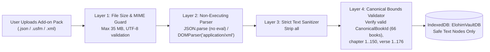

# ELOHIM BIBLE HUB — Security, Privacy & Resilience Specification
**Author:** Elder 4 — Aegis (Supreme Security & Privacy Architect)  
**Project:** ELOHIM BIBLE HUB (`c:\Users\kwame\Downloads\bible`)  
**Status:** Production Engineering Specification (v1.0.0)

---

## 1. Zero-Ad & Sovereign Privacy Manifesto

**ELOHIM BIBLE HUB** is built as a sacred, zero-surveillance digital sanctuary for scripture study:
1. **Zero Advertising Networks:** No Google AdSense, no DoubleClick, no affiliate tracking pixels, and no sponsored devotional popups will ever be loaded on the platform.
2. **Zero Behavioral Selling:** User reading histories, verse highlights, prayer/study notes, and searched Strong's numbers are treated as confidential personal convictions.
3. **100% Anonymous Local-First Default:** Users can read, compare translations, look up Hebrew/Greek lexicons, install custom language packs, highlight verses, and write study notes **without creating an account**. All data stays inside their device's encrypted browser sandbox (`ElohimVaultDB`).
4. **Opt-In Cloud Sync Only:** Network transmission of user study items occurs strictly when the user explicitly signs in via Firebase Authentication to synchronize their study vault across their own devices.

---

## 2. Firebase Authentication & Session Hardening

### 2.1 Supported Authentication Flows
- **Google OAuth 2.0 (`signInWithPopup` with automatic `signInWithRedirect` mobile fallback):** Hardened against premature popup closure traps and cross-origin opener policy issues.
- **Email & Password (`signInWithEmailAndPassword` / `createUserWithEmailAndPassword`):** Enforces minimum 8-character entropy and clean error feedback.
- **Seamless Local-to-Cloud Account Merging:**
  - When an unauthenticated scholar who has accumulated 200+ local highlights and notes in `ElohimVaultDB` signs in for the first time, the `CloudSyncDaemon` automatically adopts all `userId === 'local'` records, stamps them with the authenticated `uid`, and uploads them to `/users/{uid}/study_items` without losing a single local note.
- **Permanent Session Persistence:**
  - Configured with `browserLocalPersistence` so scholars remain signed in across hard refreshes, offline excursions, and PWA relaunches.

---

## 3. Production Cloud Firestore Security Rules (`firestore.rules`)

Every document in Cloud Firestore is locked down using strict path-level ownership (`request.auth.uid == userId`) and schema validation rules that reject oversized payloads or unauthorized cross-tenant access:

```javascript
rules_version = '2';
service cloud.firestore {
  match /databases/{database}/documents {

    // Helper functions
    function isAuthenticated() {
      return request.auth != null && request.auth.uid != null;
    }

    function isOwner(userId) {
      return isAuthenticated() && request.auth.uid == userId;
    }

    function isValidTimestamp(ts) {
      return ts is int && ts > 1700000000000 && ts < 4102444800000;
    }

    function isValidStudyItem(data, userId) {
      return data.userId == userId
        && data.entityType in ['bookmark', 'pin', 'highlight', 'note']
        && data.verseKey is string
        && data.verseKey.size() >= 5
        && data.verseKey.size() <= 24
        && data.bookId is string
        && data.bookId.size() == 3
        && data.chapter is int
        && data.chapter >= 1
        && data.chapter <= 150
        && data.verse is int
        && data.verse >= 1
        && data.verse <= 176
        && isValidTimestamp(data.updatedAtMs)
        // Guard against oversized note payloads (max 64 KB per note)
        && (!('markdownContent' in data) || (data.markdownContent is string && data.markdownContent.size() <= 65536))
        && (!('title' in data) || (data.title is string && data.title.size() <= 500))
        && (!('tags' in data) || (data.tags is list && data.tags.size() <= 30));
    }

    // User profile preferences
    match /users/{userId} {
      allow read: if isOwner(userId);
      allow create, update: if isOwner(userId)
        && request.resource.data.keys().hasOnly([
          'uid', 'email', 'displayName', 'preferredPrimaryVersion',
          'parallelVersionIds', 'updatedAtMs'
        ]);
      allow delete: if isOwner(userId);

      // Unified Study Items Vault (Bookmarks, Pins, Highlights, Notes)
      match /study_items/{itemId} {
        allow read: if isOwner(userId);
        allow create, update: if isOwner(userId)
          && isValidStudyItem(request.resource.data, userId);
        allow delete: if isOwner(userId);
      }

      // Custom Add-on Metadata Registry
      match /custom_addons/{addonId} {
        allow read: if isOwner(userId);
        allow create, update: if isOwner(userId)
          && request.resource.data.name is string
          && request.resource.data.name.size() <= 200;
        allow delete: if isOwner(userId);
      }
    }

    // Default deny all other paths
    match /{document=**} {
      allow read, write: if false;
    }
  }
}
```

---

## 4. Custom Add-on Pack Sanitization & Anti-XSS Pipeline

Because ELOHIM BIBLE HUB allows users to import third-party Bible translation files (`.json`, `.usfm`, `.osis.xml`), every imported file is treated as **untrusted external input** and passes through a 4-layer defensive gauntlet before touching `ElohimVaultDB` or the React DOM:



### 4.1 Zero-`dangerouslySetInnerHTML` Scripture Rendering
- **Scripture Verses & Custom Add-ons:** All verse text (`BibleVerse.text`), headings (`BibleVerse.heading`), and interlinear tokens (`InterlinearToken.surface`) are rendered exclusively as native React text nodes (`{verse.text}`), completely neutralizing stored or reflected XSS even if an upstream API or imported file contained malformed HTML tags.
- **XML External Entity (XXE) Prevention:** When parsing `.osis.xml` or Zefania XML files, the parser strips any `<!DOCTYPE ...>` and `<!ENTITY ...>` declarations prior to invoking `DOMParser` with `'application/xml'`.
- **Prototype Pollution Guard:** During JSON add-on validation, keys matching `__proto__`, `constructor`, or `prototype` are stripped immediately via a reviver function.

---

## 5. XSS Protection for User Study Notes (Markdown Sanitization)

Users can write rich study notes with Markdown formatting (bold, italics, lists, blockquotes, and clickable verse references like `John 1:1` or Strong's references like `H430`).

To render formatted notes safely:
1. **Custom Safe Markdown AST Renderer:** Instead of compiling Markdown into raw HTML strings and injecting them via `dangerouslySetInnerHTML`, our `SafeMarkdownNote` component parses Markdown lines into React elements (`<p>`, `<strong>`, `<em>`, `<blockquote>`, `<ul>`, `<li>`, and interactive `<VerseRefChip />` / `<StrongsRefChip />` buttons).
2. **URL Protocol Whitelist:** Any hyperlink inside a note is validated against `/^https?:\/\//i`. Links beginning with `javascript:`, `data:`, `vbscript:`, or `file:` are automatically neutralized into plain text.

---

## 6. HTTP Security Headers & Content Security Policy (CSP)

Configured in `firebase.json` for production deployment:

| Header | Value | Security Objective |
| :--- | :--- | :--- |
| `X-Frame-Options` | `SAMEORIGIN` | Prevents clickjacking and unauthorized iframe embedding. |
| `X-Content-Type-Options` | `nosniff` | Prevents MIME-sniffing attacks on uploaded or cached assets. |
| `Referrer-Policy` | `strict-origin-when-cross-origin` | Protects deep-linked verse study URLs from leaking across origins. |
| `Permissions-Policy` | `camera=(), microphone=(), geolocation=()` | Explicitly disables unnecessary hardware APIs. |

---

## 7. Offline Resilience & Disaster Recovery

1. **Quota Exceeded Self-Healing (`QuotaExceededError`):**
   - If a user installs dozens of full-Bible add-on packs and hits browser IndexedDB storage limits on a low-storage mobile device, `ElohimVaultDB` catches `QuotaExceededError`, evicts the oldest non-pinned API-cached chapters from `chapters_store` (preserving 100% of `study_items_store` and `addons_store`), and retries the write seamlessly.
2. **1-Click Study Vault Backup & Restore (`.elohim-backup.json`):**
   - Even without a cloud account, scholars can export their entire `study_items_store` (Bookmarks, Pins, Highlights, and Notes) to a portable JSON backup file at any time and restore it on any device.
